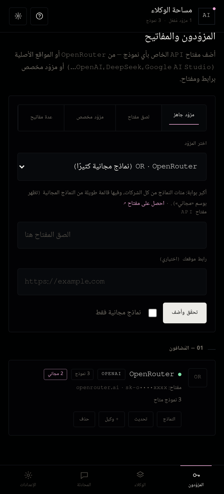
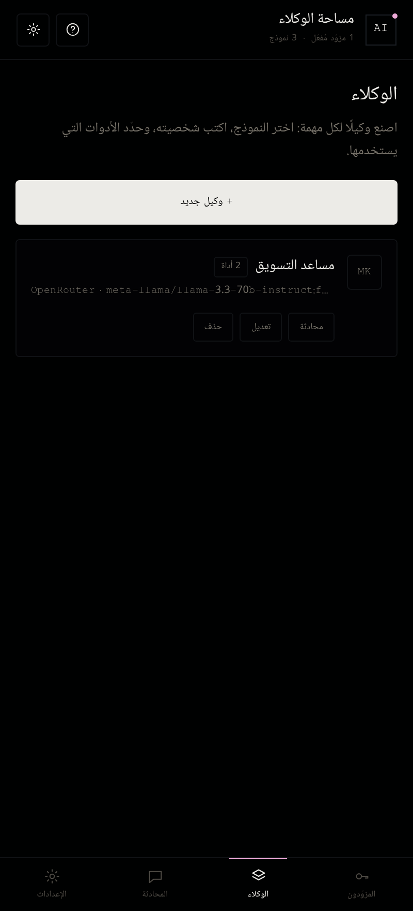
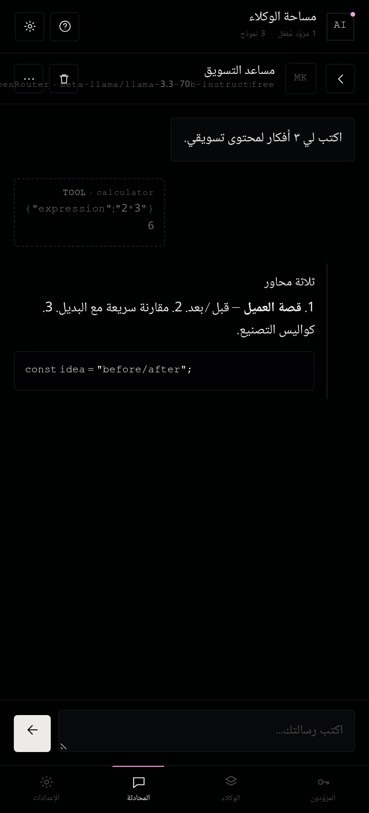
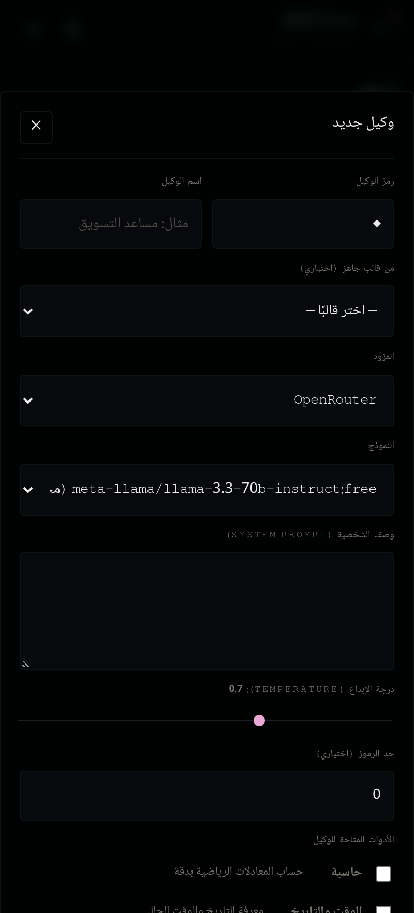

# 🤖 مساحة الوكلاء — AI Agents Space

تطبيق يعطيك مساحة لتشغيل **وكلاء ذكاء اصطناعي** بنفسك: تُدخل مفتاح الـ API الخاص بأي مزوّد،
يتحقّق التطبيق من أن المفتاح يعمل، ثم يجلب قائمة النماذج المتاحة، وبعدها تُنشئ وكلاء وتبدأ المحادثة.

يعمل **بالكامل من جهازك** — بدون سيرفر وسيط، وبدون دومين. كل المفاتيح تُخزَّن محليًا على جهازك فقط.

---

## ✨ المزايا

### ١) أربع طرق لإضافة المفتاح
| الطريقة | الوصف |
|---|---|
| **مزوّد جاهز** | اختر من قائمة: OpenRouter، OpenAI، DeepSeek، Google AI Studio، Anthropic، Groq، Mistral، Together، xAI، Fireworks، Cerebras، Ollama، LM Studio |
| **لصق مفتاح (تلقائي)** | الصق المفتاح فقط، والتطبيق يتعرّف على المزوّد من شكل المفتاح (`sk-or-` → OpenRouter، `AIza` → Google، `sk-ant-` → Anthropic، `gsk_` → Groq…) ويجرّب المزوّدين المحتملين واحدًا واحدًا حتى ينجح |
| **مزوّد مخصص** | أدخل رابط الـ API (Base URL) + المفتاح، واختر نوع الـ API (OpenAI-compatible / Gemini / Anthropic)، مع إمكانية تخصيص ترويسة التحقق ومسار جلب النماذج |
| **عدة مفاتيح** | الصق عدة مفاتيح (سطر لكل مفتاح) ليضيفها كلها، أو استورد ملف إعدادات JSON |

### ٢) التحقق قبل الجلب (كما طلبت)
كل عملية إضافة تمرّ بخطوتين إلزاميتين بالترتيب:

1. **التحقق من المفتاح** — يتصل التطبيق بالمزوّد ويتأكد أن المفتاح صالح.
   - OpenRouter: نقطة النهاية `/key`
   - المتوافقون مع OpenAI: `/models`
   - Gemini: `/models?key=…`
   - Anthropic: `/models` مع `x-api-key`
2. **جلب النماذج** — بعد نجاح التحقق فقط، تُجلب قائمة النماذج وتُحفظ.

لو كان المفتاح خاطئًا تظهر رسالة المزوّد الحقيقية (مثل: `Incorrect API key provided…`)، ولا يُحفظ أي شيء.

### ٣) النماذج المجانية
OpenRouter يعطي وسمًا تلقائيًا للنماذج المجانية (`pricing.prompt == "0"`)، ويمكنك تشغيل خيار
**«نماذج مجانية فقط»** لتصفية القائمة.

### ٤) الوكلاء
- أنشئ وكيلًا لكل مهمة: اسم، رمز، نموذج، شخصية (System Prompt)، درجة الإبداع.
- **قوالب جاهزة**: مفكّر، مبرمج، كاتب، باحث، مترجم، مساعد عام.
- **أدوات يستخدمها الوكيل تلقائيًا** (Function Calling):
  - 🧮 حاسبة دقيقة (بدون تنفيذ كود خطير)
  - 🕒 الوقت والتاريخ
  - 🌐 جلب محتوى أي رابط وقراءته
  - 🔗 إرسال طلبات HTTP لأي API
  - 📋 سرد النماذج المتاحة

### ٥) محادثة
بث الردود مباشرة (Streaming)، عرض الماركداون وكتل الكود، إظهار خطوات استخدام الأدوات، سجل محفوظ لكل وكيل.

---

## 🚀 كيف تشغّله

### أ) على الكمبيوتر (متصفح)
```bash
cd /workspace
python3 -m http.server 8080
# افتح http://localhost:8080
```

### ب) على الأندرويد (APK)
ملف جاهز ومُوقَّع في: **`dist/ai-agents-space.apk`**

للتركيب: انسخ الملف لهاتفك، افتحه، واسمح بـ «تثبيت من مصادر غير معروفة».
أو عبر adb: `adb install dist/ai-agents-space.apk`

**إعادة البناء من المصدر:**
```bash
./build-apk.sh     # يبني dist/ai-agents-space.apk (aapt2 + javac + d8 + apksigner)
```

### ج) كتطبيق ويب مثبَّت (PWA)
حمّل مجلد المشروع على أي استضافة، أو شغّل السيرفر المحلي واختر «إضافة إلى الشاشة الرئيسية».

---

## ⚙️ ملاحظة تقنية مهمة: لماذا لا توجد مشكلة CORS في الـ APK؟
من داخل المتصفح، الاتصال المباشر ببعض المزوّدين قد يُحجب بسياسة CORS.
لذلك في نسخة الأندرويد يوجد **جسر شبكة أصلي** (`HttpBridge.java`) ينفّذ الطلبات من داخل التطبيق
ويعيد النتائج إلى الواجهة مع دعم البث — فلا قيود CORS ولا حاجة لأي سيرفر وسيط.

---

## 🗂 هيكل المشروع
```
index.html                 واجهة التطبيق
assets/css/app.css         التنسيقات
assets/js/core.js          أدوات مساعدة + تخزين محلي + طبقة الشبكة (fetch أو الجسر الأصلي)
assets/js/providers.js     سجلّ المزوّدين + التحقق + جلب النماذج + الاكتشاف التلقائي
assets/js/chat.js          تكييف المحادثة لكل مزوّد (OpenAI / Gemini / Anthropic) + البث
assets/js/tools.js         أدوات الوكلاء
assets/js/agent.js         تعريف الوكلاء + حلقة تنفيذ الأدوات
assets/js/ui.js            الواجهة
assets/js/boot.js          الربط والإقلاع
android/                   مشروع الأندرويد (بدون Gradle)
build-apk.sh               سكربت بناء الـ APK
tests/                     اختبارات (منطق + شبكة حيّة)
```

---

## 🔒 الخصوصية
- مفاتيحك تُخزَّن في `localStorage` على جهازك فقط.
- لا يوجد أي سيرفر وسيط، ولا إرسال بيانات لأي طرف ثالث.
- تصدير النسخة الاحتياطية يُنتج ملف JSON يحتوي مفاتيحك — احفظه في مكان آمن.

---

## 🧪 الاختبارات
```bash
node tests/smoke.js   # ٢٨ اختبارًا للمنطق (اكتشاف المفاتيح، الترويسات، تحليل النماذج، الأدوات…)
node tests/live.js    # اختبار حيّ: يجلب النماذج من OpenRouter ويتأكد من رفض المفاتيح الخاطئة
```

---

## 🎨 الشكل الجديد

التصميم أُعيد بناؤه بالكامل على نمط `v0-compute` المرجعي:
أسود نقي `#000101` · أبيض دافئ `#ecebe7` · حدود شعرية `#101215` · حواف `4px` ·
خط `Mono` للعناوين الصغيرة والأرقام · ولمسة وردي `#eca8d6` للتفاصيل النشطة.

| المزوّدون | الوكلاء | المحادثة | محرّر الوكيل |
|---|---|---|---|
|  |  |  |  |

---

## 🐞 الأخطاء التي أُصلحت

1. **التطبيق كان متوقفًا تمامًا عن الاستجابة** — النافذة المنبثقة كانت مخفية بخاصية `hidden`،
   لكن قاعدة CSS `.modal{display:flex}` كانت تتغلّب عليها، فبقيت طبقة ضبابية تغطي الشاشة
   وتمنع كل اللمسات. الحل: `[hidden]{display:none !important}` (ونفس المشكلة في زر الإيقاف).
2. **التخزين المحلي** — كان التطبيق يُحمَّل من `file://` وهذا يمنع `localStorage` على بعض
   أجهزة أندرويد (فلا تُحفظ المفاتيح). الحل: أصبح يُخدم من نطاق `https` محلي داخلي عبر
   `shouldInterceptRequest`، فيعمل التخزين بثقة على كل الأجهزة.
3. **توافق WebView القديم** — أُضيفت بدائل لـ `Element.closest` و `Object.assign`،
   وأداة تشخيص تُظهر أي خطأ JS كتنبيه بدل أن تفشل الواجهة بصمت.
4. **رموز لا تظهر** — أُزيلت الرموز والإيموجي من الأزرار والعناوين (كانت تظهر كمربعات فارغة)
   واستُبدلت باختصارات نصية مثل `OR` و `OA`.
5. **تفاصيل بصرية** — شريط التمرير صار بلون التصميم، ومحاذاة الحقول اللاتينية (المفاتيح
   والروابط) من اليسار، واقتطاع النصوص الطويلة بنقاط بدل كسر الكلمات.

---

## 🧪 الاختبارات

```bash
node tests/smoke.js     # ٢٨ اختبارًا للمنطق (اكتشاف المفاتيح، الترويسات، تحليل النماذج، الأدوات…)
node tests/dom.js       # ٣٣ اختبارًا للواجهة كاملة داخل DOM حقيقي مع مزوّد وهمي
node tests/live.js      # اختبار شبكة حيّ (جلب نماذج OpenRouter ورفض المفاتيح الخاطئة)
node tests/browser.js   # تشغيل متصفح حقيقي + لقطات شاشة (يتطلب Chrome)
```
